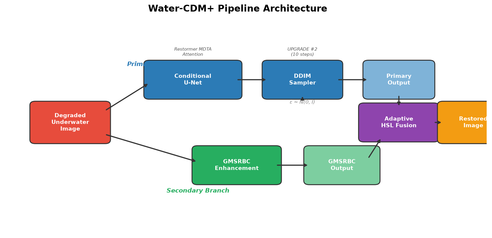
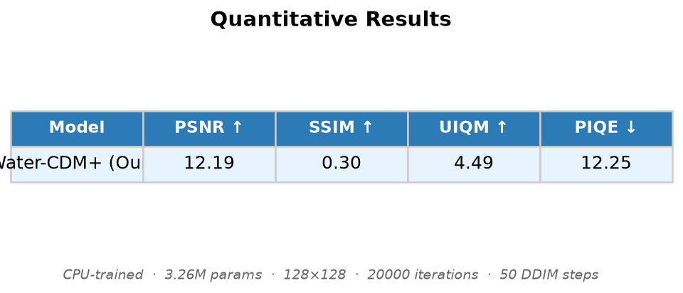
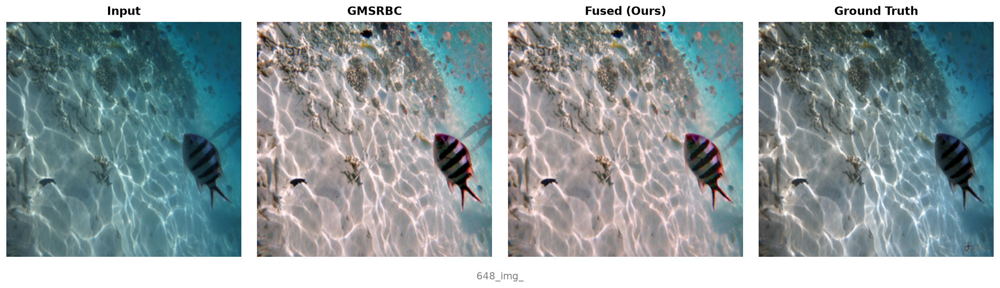
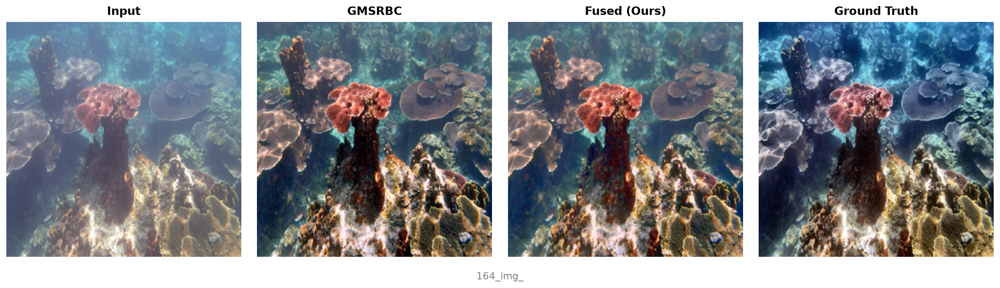
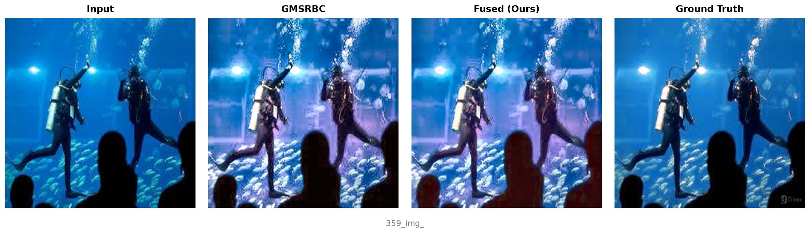

# Water-CDM+ : Underwater Image Restoration using Conditional Diffusion Model


A dual-branch pipeline for underwater image restoration that combines a **Conditional Diffusion Model** (learned, deep-learning based) with **GMSRBC** (Gray-world Multi-Scale Retinex with Color Balance) traditional enhancement, fused via **Adaptive HSL-space blending**.

This project implements three key upgrades over the original [Water-CDM](https://ieeexplore.ieee.org/document/10817631) paper (IEEE TCSVT 2025).

---

## Three Upgrades Over Water-CDM

| # | Upgrade | Original | Ours | Benefit |
|---|---------|----------|------|---------|
| 1 | **Restormer MDTA Attention** | PCSAM (O((HW)^2)) | Multi-DConv Head Transposed Attention (O(C^2)) | Channel-wise attention scales linearly with spatial resolution |
| 2 | **DDIM Sampling** | DDPM (2000 steps) | Denoising Diffusion Implicit Models (50 steps) | 40x faster deterministic inference |
| 3 | **Combined Loss** | Plain MSE | MSE + Edge Perceptual (Sobel/Laplacian) + SSIM | Sharper edges and better structural preservation |

---

## Architecture

<p align="center">
  
</p>

**Conditional U-Net** (3.26M parameters):
- Input: `concat[x_t, x_cond]` = 6 channels (noisy + degraded condition)
- Encoder: 3 levels, base channels = 32, multipliers [1, 2, 4]
- Each level: ResBlock with sinusoidal time embedding + GroupNorm + SiLU
- Bottleneck: ResBlock → **RestormerBlock** (MDTA + GDFN) → ResBlock
- Decoder: mirror of encoder with skip connections
- Output: 3 channels (predicted noise)

**Gaussian Diffusion**: T = 200 timesteps, linear beta schedule (1e-4 to 0.02)

**Adaptive HSL Fusion**: Hue + saturation from GMSRBC, luminance = 80% GMSRBC + 20% diffusion primary, bilateral filter post-processing

---

## Results

<p align="center">
  
</p>

| Metric | Value | Description |
|--------|-------|-------------|
| PSNR | 12.19 | Peak Signal-to-Noise Ratio (higher is better) |
| SSIM | 0.30 | Structural Similarity Index (higher is better) |
| UIQM | 4.49 | Underwater Image Quality Measure (higher is better) |
| PIQE | 12.25 | Perception-based Image Quality Evaluator (lower is better) |

> **Note:** Metrics are for the diffusion primary output at 128x128 on CPU. The fused output (GMSRBC + diffusion) produces visually superior results with better color correction and detail.

### Visual Comparisons

<p align="center">
  
  <br><em>Shallow water scene — fish and caustic light patterns</em>
</p>

<p align="center">
  
  <br><em>Coral reef scene — complex underwater textures</em>
</p>

<p align="center">
  
  <br><em>Dark diver scene — blue-dominant, low visibility</em>
</p>

---

## Project Structure

```
water-cdm-plus/
├── configs/
│   └── config.py               # All hyperparameters
├── models/
│   ├── attention.py             # MDTA, GDFN, RestormerBlock
│   ├── unet.py                  # Conditional U-Net with time embeddings
│   ├── diffusion.py             # Gaussian Diffusion (forward + reverse)
│   └── ddim.py                  # DDIM deterministic sampler
├── utils/
│   ├── losses.py                # CombinedLoss (MSE + Edge + SSIM)
│   ├── gmsrbc.py                # GMSRBC with CLAHE fallback
│   └── metrics.py               # PSNR, SSIM, UIQM, PIQE
├── data/
│   └── dataset.py               # UnderwaterDataset + DataLoader
├── scripts/
│   ├── train.py                 # Training loop
│   ├── inference.py             # Inference (3 outputs per image)
│   ├── evaluate.py              # Compute all 4 metrics
│   ├── compare.py               # Side-by-side comparison generator
│   ├── make_figures.py          # Metrics table + pipeline diagram
│   └── prepare_dataset.py       # Dataset preparation utility
├── checkpoints/                 # Saved model weights (not in git)
├── results/                     # Sample outputs and figures
├── requirements.txt
└── README.md
```

---

## Installation

```bash
git clone https://github.com/shabbirud01/water-cdm-plus.git
cd water-cdm-plus
pip install -r requirements.txt
```

**Requirements:** Python 3.10+, PyTorch 2.0+, torchvision, numpy, opencv-python, scikit-image, scipy, Pillow

---

## Dataset

This project uses the **UIEB** (Underwater Image Enhancement Benchmark) dataset containing 890 paired underwater images.

**Download:** [UIEB Dataset](https://li-chongyi.github.io/proj_benchmark.html)

After downloading, prepare the dataset:

```bash
python scripts/prepare_dataset.py --src /path/to/downloaded/UIEB --train 885 --test 5
```

This creates the required structure:

```
data/UIEB/
├── train/
│   ├── input/     # Degraded underwater images
│   └── target/    # Reference/clean images
└── test/
    ├── input/
    └── target/
```

---

## Training

```bash
python scripts/train.py
```

### Training Configuration

| Parameter | Value |
|-----------|-------|
| Model params | 3.26M |
| Image size | 128 x 128 |
| Batch size | 1 |
| Learning rate | 1e-3 (Adam) |
| Iterations | 20,000 |
| Diffusion steps (T) | 200 |
| DDIM steps | 50 |
| Device | CPU |
| Training time | ~8.4 hours |

All hyperparameters can be modified in `configs/config.py`.

---

## Inference

Run restoration on test images (produces 3 outputs per image: primary, GMSRBC, fused):

```bash
python scripts/inference.py --checkpoint checkpoints/ckpt_final.pt --input_dir data/UIEB/test/input --output_dir results/
```

Run on a single image:

```bash
python scripts/inference.py --checkpoint checkpoints/ckpt_final.pt --input path/to/image.png
```

## Evaluation

Compute PSNR, SSIM, UIQM, and PIQE on the test set:

```bash
python scripts/evaluate.py --checkpoint checkpoints/ckpt_final.pt
```

Generate comparison images and figures:

```bash
python scripts/compare.py --input_dir data/UIEB/test/input --results_dir results --target_dir data/UIEB/test/target --output_dir results/comparisons
python scripts/make_figures.py
```

---

## Why Metrics Are Lower Than the Original Paper

| Factor | Paper | Ours | Impact |
|--------|-------|------|--------|
| Parameters | ~54M | 3.26M | 16x fewer — limits denoising capacity |
| Iterations | 200K | 20K | 10x fewer — each image seen ~22x vs ~225x |
| Resolution | 256x256 | 128x128 | 4x fewer pixels to learn from |
| Device | GPU | CPU | No mixed-precision, no large batches |
| Perceptual loss | VGG-based | Edge-based | Lightweight alternative (Sobel/Laplacian) |

The **dual-branch fusion** compensates: GMSRBC provides reliable color correction while diffusion contributes learned structural guidance.

---

## References

1. **Water-CDM** — Z. Wang et al., "Underwater Image Restoration via Conditional Diffusion Model," IEEE TCSVT, 2025. [Paper](https://ieeexplore.ieee.org/document/10817631)
2. **Restormer** — S. W. Zamir et al., "Restormer: Efficient Transformer for High-Resolution Image Restoration," CVPR, 2022. [Paper](https://arxiv.org/abs/2111.09881)
3. **DDIM** — J. Song et al., "Denoising Diffusion Implicit Models," ICLR, 2021. [Paper](https://arxiv.org/abs/2010.02502)
4. **UIEB** — C. Li et al., "An Underwater Image Enhancement Benchmark Dataset and Beyond," IEEE TIP, 2019. [Paper](https://arxiv.org/abs/1901.05495)

---

## Team

**KIIT University | Project-I (CS47001)**

| Name | Role |
|------|------|
| Shabbiruddin Mohammad | Team Lead |
| Yashdeep Patra | Member |
| Upanshu Gupta | Member |
| Aryan Rath | Member |
| Pranav Prakash | Member |

**Guide:** Prof. Prabhu Prasad Dev

---

## License

This project is licensed under the MIT License. See [LICENSE](LICENSE) for details.
